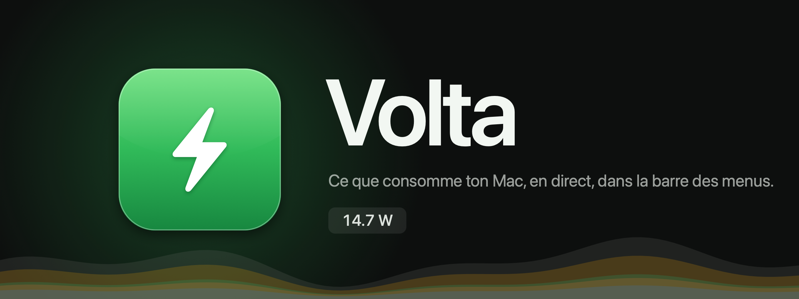
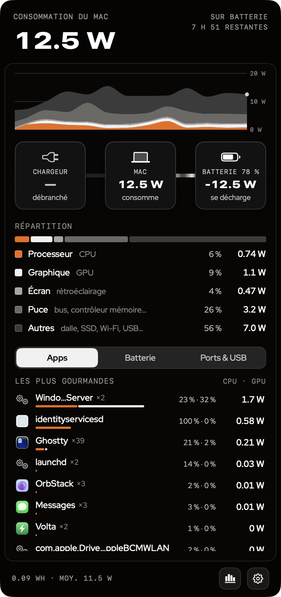
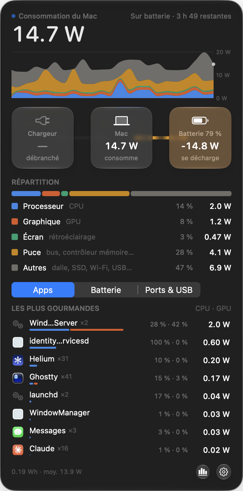
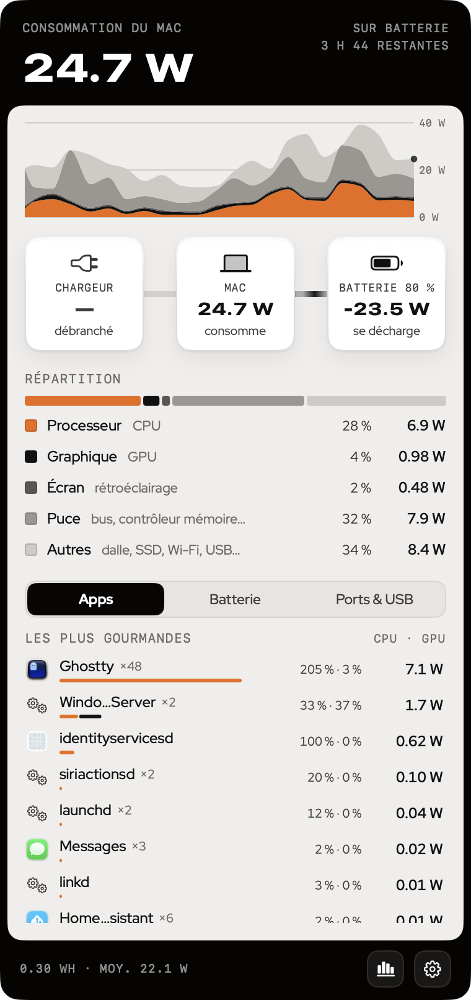
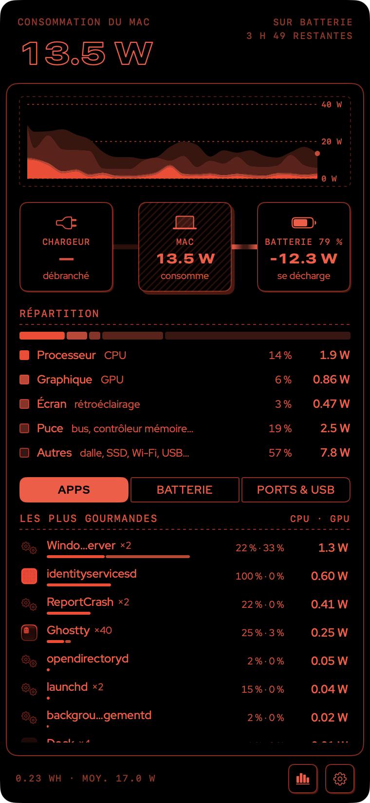

<p align="center">
  
</p>

<p align="center">
  <b>Ce que consomme ton Mac, en watts et en direct : dans la barre des menus, et dans un panneau qui dit où part l'énergie.</b><br>
  Swift · SwiftUI · Core Animation · aucune dépendance · aucun droit administrateur · macOS 26+ · Apple Silicon
</p>

<p align="center">
  <a href="https://github.com/matthieuleconte1/Volta/releases/latest"><b>Télécharger la 2.1</b></a> ·
  <a href="#ce-que-fait-volta">Fonctionnalités</a> ·
  <a href="#deux-styles">Deux styles</a> ·
  <a href="#installation">Installation</a> ·
  <a href="#doù-viennent-les-mesures">Les mesures</a>
</p>

<p align="center">
  
</p>

## Nouveau dans la 2.1

- **Mesures alignées sur [Stats](https://github.com/exelban/stats).** La consommation du Mac vient du capteur « System Total » du SMC (`PSTR`),
  le CPU et le GPU des compteurs IOReport « Energy Model ». L'ancien calcul (chargeur − batterie) comptait les pertes de charge
  comme de la consommation : il ne sert plus que de repli.
- **Compteurs morts détectés.** Sur macOS 27, le compteur CPU d'IOReport ne bouge plus : Volta le voit et prend le capteur SMC
  à la place, au lieu d'afficher 0 W (ce que ferait Stats).
- **Puissance moyenne** depuis le lancement, à côté de l'énergie consommée.
- **Beaucoup plus sobre.** En style Glyphe, chaque ouverture du panneau laissait une interface invisible tourner après la fermeture :
  jusqu'à ~50 % de CPU au bout de quelques jours. Panneau fermé, Volta est maintenant à ~0 %.
- Un second clic sur l'icône referme le panneau, comme les autres icônes de la barre des menus.

## Ce que fait Volta

- **Barre des menus** : la puissance consommée par le Mac, ou au choix celle du chargeur ou le flux de la batterie.
  Une alerte fait passer la valeur en couleur au-delà d'un seuil.
- **Flux d'énergie** : chargeur → Mac ⇄ batterie, façon AlDente, avec un canal où l'énergie s'écoule plus vite quand il passe plus de watts.
- **Historique** sur 5, 15 ou 30 minutes, empilé par composant ; on le survole pour remonter le temps.
- **Répartition** : processeur, graphique, écran, reste de la puce, autres (SSD, Wi-Fi, USB…).
- **Les apps les plus gourmandes**, en watts (CPU + GPU), regroupées comme dans le Moniteur d'activité : une app compte avec ses helpers.
- **Batterie et chargeur** : santé, cycles, capacité, température, profil négocié avec le chargeur, tension et courant mesurés.
- **Ports et USB** : ports USB-C / MagSafe utilisés, appareils branchés et budget de puissance que le Mac leur réserve.

## Deux styles

Un style décide de tout : surfaces, couleurs, typographie, contrôles et mouvement. Le choix se fait dans **Réglages › Apparence › Style**.

<table>
  <tr>
    <td width="25%"><p align="center"><b>Verre</b></p></td>
    <td width="25%"><p align="center"><b>Glyphe · Jour</b></p></td>
    <td width="25%"><p align="center"><b>Glyphe · Sombre</b></p></td>
    <td width="25%"><p align="center"><b>Glyphe · Nuit</b></p></td>
  </tr>
</table>

| Style | Matière | Mouvement |
|---|---|---|
| **Verre** | Liquid Glass, palette (Classique, Océan, Néon, Pastel, Mono) et accent réglables, verre givré ou transparent | les sections glissent et apparaissent en cascade |
| **Atelier Glyphe** | cadre noir en retrait, panneau intérieur, planches au filet d'un pixel, un seul accent (orange, ambre, vert, corail, violet ou mono), Zalando Sans Expanded pour les chiffres, Red Hat Display pour le texte, libellés en mono capitales | ressorts physiques, sections qui montent en cascade, chargeur « comète de points » |

Atelier Glyphe a quatre thèmes : **Auto**, **Jour** (papier chaud), **Sombre** (noir chaud) et **Nuit**, automatique aux heures choisies :
tout passe dans un seul rouge et la forme prend le relais (surfaces au trait, ombres décalées, capitales, icônes plus fines).

## Réglages

La roue crantée en bas du panneau ouvre les **Réglages**, qui s'appliquent en direct :

- **Barre des menus** : valeur affichée, icône de charge (à gauche ou à droite), seuil d'alerte.
- **Mesures** : rafraîchissement panneau ouvert (1, 2 ou 5 s), durée de l'historique (5, 15 ou 30 min).
- **Sections** : afficher ou masquer le graphique, le flux d'énergie, la répartition, les détails ; le panneau se redimensionne.
- **Apparence** : style, thème et accent, densité, police des chiffres, graphique empilé ou total, flux en canal ou en points,
  animations complètes, discrètes ou aucune. « Réduire les animations » de macOS plafonne automatiquement aux animations discrètes.

## Installation

Le plus simple : télécharger le `.dmg` de la [dernière version](https://github.com/matthieuleconte1/Volta/releases/latest),
glisser Volta dans Applications et l'ouvrir. Volta n'est pas notarisé : au premier lancement, passer par
**Réglages Système › Confidentialité et sécurité › Ouvrir quand même** (tout est expliqué dans le `LISEZ-MOI.txt` du `.dmg`).

Depuis les sources :

```sh
git clone https://github.com/matthieuleconte1/Volta.git && cd Volta
./build.sh install    # compile, copie dans /Applications et lance
```

Il suffit des outils en ligne de commande d'Apple (`xcode-select --install`) : pas besoin d'Xcode.
`./build.sh dist` produit `build/Volta-<version>.dmg` et `.zip` pour une release ; la version est en tête de `build.sh`.

> Volta s'appelait **Wattchdog**. Au premier lancement, il reprend tout seul les réglages de l'ancienne app.

## D'où viennent les mesures

Mêmes sources que l'app open source [Stats](https://github.com/exelban/stats) : les capteurs de puissance du SMC
et les compteurs IOReport « Energy Model » de la puce. Aucun droit administrateur n'est nécessaire.

| Mesure | Source |
|---|---|
| Consommation du Mac | SMC `PSTR` (« System Total », comme Stats) ; repli : chargeur − flux batterie, puis IOKit `SystemLoad` |
| Batterie, chargeur | SMC `B0AV` × `B0AC` (signé : + en charge), `PDTR` ; repli : IOKit `AppleSmartBattery` |
| Processeur | IOReport `CPU Energy` (comme Stats), repli SMC `PP0C` : sur macOS 27 ce compteur ne bouge plus |
| Graphique | IOReport `GPU Energy` (comme Stats), repli SMC `PG0C` |
| Écran | SMC `PDBR` jusqu'aux M4, `PBwo` à partir des M5 (rétroéclairage de l'écran intégré) |
| Puce (reste du SoC) | SMC `PHPC` (« Heatpipe Power » : tout le SoC) − processeur − graphique |
| Apps | compteurs d'énergie des coalitions du noyau (`coalition_info_resource_usage`, même regroupement que le Moniteur d'activité, helpers et processus terminés inclus), temps GPU par processus du pilote AGX |
| Énergie, moyenne | intégrale de la consommation depuis le lancement, et sa moyenne (« Average System Total » de Stats) |
| Ports, USB | IOKit (`AppleHPMInterface`, `IOUSBHostDevice`) : macOS ne mesure pas la consommation réelle de chaque port |

Un compteur IOReport n'est pris en compte qu'après avoir bougé deux mesures de suite : un compteur mort ou rafraîchi
par à-coups retombe sur le capteur SMC au lieu d'afficher 0 W ou un pic.

Pour classer les apps, Stats lance `top` à chaque rafraîchissement et obtient un score d'impact. Volta lit directement les compteurs
d'énergie du noyau : de vrais watts, sans lancer de processus.

## Sobriété

- **Panneau fermé** : une mesure toutes les 5 s (quelques capteurs SMC et deux compteurs IOReport), aucune interface en vie. ~0 % CPU.
- **Panneau ouvert** : une mesure toutes les 2 s, plus le suivi par app (un appel noyau par coalition). ~1,7 % CPU.
  L'interface est détruite à la fermeture.
- Les animations liées aux mesures (chiffre qui défile, barres, point « live », flux d'énergie, chargeur) sont confiées à
  Core Animation : l'app valide le nouvel état une fois, le serveur de rendu interpole. Faites en SwiftUI, les mêmes animations
  coûtaient 20 à 40 % de CPU.
- Les animations SwiftUI restantes ne se déclenchent que sur une action : ouverture, survol, onglets, réglages.

## Sous le capot

Environ 4 500 lignes de Swift, sans dépendance, dans un Swift Package (pas de projet Xcode).

| Fichier | Rôle |
|---|---|
| `App.swift` | l'icône de la barre des menus, son texte, l'ouverture et la fermeture du panneau |
| `GlassPanel.swift` | le panneau sous la barre des menus : Liquid Glass ou surface opaque, redimensionnement, fermeture |
| `PowerStore.swift` | l'échantillonneur : rythme panneau ouvert / fermé, historique, énergie, valeur de la barre des menus |
| `SMC.swift`, `IOReport.swift` | lecture des capteurs du SMC et des compteurs IOReport « Energy Model » |
| `Battery.swift`, `Ports.swift` | batterie et chargeur (IOKit), ports USB-C / MagSafe et appareils USB |
| `Processes.swift` | énergie par app : coalitions du noyau et temps GPU par processus |
| `PopoverView.swift`, `SettingsView.swift` | le panneau et la page de réglages en SwiftUI |
| `LayerViews.swift`, `Mark.swift` | les animations en Core Animation : barres, chiffre qui défile, canal d'énergie, chargeur |
| `Styles.swift`, `Night.swift`, `Motion.swift`, `Fonts.swift` | les deux styles, la Nuit de Glyphe, les ressorts, les polices livrées |
| `Settings.swift` | les réglages et leur enregistrement |

L'icône et la bannière sont dessinées par du code : `swift scripts/make_icon.swift Resources/AppIcon.icns`
et `swift scripts/make_banner.swift docs/banner.png`.

## Merci

À [Stats](https://github.com/exelban/stats) (exelban), dont Volta reprend les sources de mesure.
Polices : [Red Hat Display](https://github.com/RedHatOfficial/RedHatFont) (SIL Open Font License).
